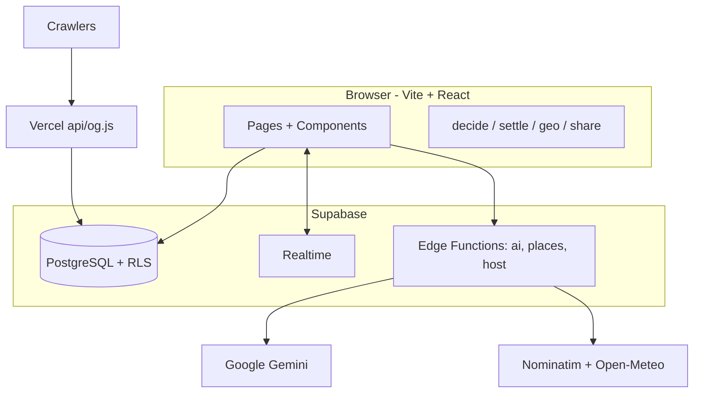

# ChaloPlan 🎒 — Effortless Group Planning in One Link

**HackOnVibe Nov 2026** | **Solo Project by Mansi Yadav**

[](https://chaloplan.vercel.app/)
[](https://youtu.be/C4Ju3TZvO2k)


🔗 **Live app:** https://chaloplan.vercel.app/
🎥 **Demo video:** https://youtu.be/C4Ju3TZvO2k

[](https://youtu.be/C4Ju3TZvO2k)

> Group plans die in chat threads. ChaloPlan brings them to life in a single link: live voting, an AI-crafted itinerary, task assignments, and expense splitting. Friends need **zero signups**, and every shared plan is built to spread to new groups.

---

## ⚡ Try it in 30 seconds

1. Open **https://chaloplan.vercel.app/** and click **Create a plan**.
2. Pick a plan type, add 2–4 dates and destinations, set a budget band.
3. Copy the link, open it in a second tab or on your phone, and vote as a guest. Watch the results update live.

## 📸 Screenshots


## 🌟 The Pitch

**Problem:** Group plans almost always fail in messy chat threads. Hundreds of messages about "when should we go?" and "where to?" lead to scattered dates, mismatched budgets, and endless indecision.

**Solution:** One person creates a plan in 30 seconds and shares a single link. Friends vote in 10 seconds without downloading an app or creating an account. The platform deterministically finds the winning date, destination, and budget, then Google Gemini writes the day-by-day itinerary, assigns tasks, and the app calculates minimum-transaction expense splits.

**One-liner:** *"Group plans die in chat threads. ChaloPlan brings them to life in a single link, engineered to spread virally to new groups with every plan."*

## ✨ Key Features

- **Zero signup friction:** one link, and friends just enter their name and vote in 10 seconds.
- **AI-powered itineraries:** Google Gemini 2.0 Flash generates schedules, cost breakdowns, packing lists, and task assignments.
- **Real-time voting:** Supabase Realtime pushes live updates as votes arrive.
- **Fair and deterministic decisions:** scoring runs in code (not in the AI) to pick the winning date, place, and median budget. The AI only writes the narrative.
- **Greedy expense settlement:** a graph-based algorithm minimizes the number of peer-to-peer payments, with UPI deep links and QR codes.
- **Calendar export:** a standard `.ics` invite that works with Google Calendar and Apple Calendar.
- **Shareable story cards:** a 9:16 Boarding Pass PNG with a short PNR code and QR.
- **Organic viral loop:** every shared plan and story card carries `?ref=` tracking, with a live K-factor dashboard at `/stats`.
- **Crawler-friendly link previews:** WhatsApp, Twitter, Telegram, LinkedIn and Slack unfurl a rich card for each plan.

## 📊 How It Works


### 1. Create (30 seconds)
The host selects a plan type (Trip, Movie, Birthday, Party, Dinner, or Custom), sets 2–4 dates, destinations, and a budget band.

### 2. Share
A pre-formatted invite message and a Social Story Card (9:16 PNG) are generated instantly with a short PNR code and QR.

### 3. Vote (10 seconds per friend)
No app install or signup. Friends open the link on mobile or desktop, tap Yes / Maybe / No for dates, pick favorite destinations, and submit a budget preference.

### 4. Deterministic decision + AI plan
- **Winning date:** highest weighted score (`Yes` = 2 points, `Maybe` = 1 point, `No` = 0).
- **Winning destination:** highest number of positive votes (tie-breaks are explained by the AI).
- **Optimal budget:** the statistical median of all participant inputs, so outliers can't skew the cost.
- **Gemini 2.0 Flash:** crafts a day-by-day itinerary, expense breakdown, and smart packing list.

### 5. Lock and calendar export
The host reviews and locks the plan. Participants get a standard `.ics` calendar invitation.

### 6. Automated task assignment
AI generates preparation tasks (transport booking, snacks, packing essentials) and distributes them among participants.

### 7. Expense splitting and one-click settlement
Participants log shared expenses. A greedy algorithm computes the minimum number of payments needed and provides direct UPI deep links and QR codes.

## 🧮 How the Decision Algorithm Works

All decisions are made in code (`src/lib/decide.js`) *before* the AI is called, so results are reproducible and explainable.

**Example:** 3 friends vote on two dates, two destinations, and a budget.

| Voter | Date A | Date B | Destination | Budget (₹) |
| --- | :---: | :---: | --- | ---: |
| Ana | Yes | Maybe | Goa | 8,000 |
| Ben | Maybe | Yes | Goa | 10,000 |
| Chai | Yes | No | Manali | 15,000 |

- **Date A:** 2 + 1 + 2 = **5 points**, **Date B:** 1 + 2 + 0 = **3 points**, so **Date A wins**.
- **Destination:** Goa has 2 votes and Manali has 1, so **Goa wins**.
- **Budget:** the median of 8,000 / 10,000 / 15,000 is **₹10,000**.

These facts are then handed to Gemini to write the itinerary, so the AI never decides who wins.

**Expense settlement** (`src/lib/settle.js`): net balances are computed per person, then the largest debtor is repeatedly matched with the largest creditor. This keeps the number of payments at most *n − 1* for *n* people.

## 🏗️ Architecture



## 🚀 Tech Stack

| Layer | Technology |
| --- | --- |
| **Frontend** | Vite + React + Tailwind CSS + Framer Motion |
| **Backend** | Supabase (PostgreSQL + Realtime + Storage + Deno Edge Functions) |
| **AI engine** | Google Gemini 2.0 Flash |
| **Geodata** | OpenStreetMap (Nominatim API) + Open-Meteo |
| **3D** | `@react-three/fiber` globe on `/dashboard`, lazy-loaded so it never ships to the vote page |
| **Deployment** | Vercel (SPA + serverless `api/og.js` for crawler link previews) |

## 📁 Project Structure

```
chaloplan/
├── src/
│   ├── lib/              # Core business logic
│   │   ├── supabase.js   # Database client & real-time listeners
│   │   ├── ai.js         # Gemini AI wrappers
│   │   ├── decide.js     # Deterministic voting & decision algorithm
│   │   ├── settle.js     # Greedy expense settlement algorithm
│   │   ├── geo.js        # Haversine distance & central meeting point
│   │   ├── share.js      # WhatsApp, Calendar (.ics), & card generation
│   │   └── ...
│   ├── pages/
│   │   ├── Landing.jsx   # Hero + interactive ticket interface
│   │   ├── NewPlan.jsx   # 3-step creation wizard
│   │   ├── PlanPage.jsx  # Live voting + AI itinerary + tasks + expenses
│   │   ├── Share.jsx     # QR code + WhatsApp sharing + story card
│   │   ├── Stats.jsx     # Viral K-factor & growth analytics
│   │   └── Dashboard.jsx # "My Plans" + lazy 3D globe (this device's plans)
│   └── components/       # Design system components
├── api/
│   └── og.js             # Serverless Open Graph HTML for WhatsApp/Twitter crawlers
├── supabase/
│   ├── schema.sql        # Full database schema + Row Level Security
│   └── functions/
│       ├── ai/           # Gemini AI Edge Function
│       ├── places/       # Geocoding & Weather Edge Function
│       └── host/         # Host-authorized operations Edge Function
├── docs/
│   └── screenshots/      # README images
└── .env.example          # Placeholder env names (no values)
```

## 📈 Viral Growth Architecture

- **Loop 1 (Voter → Host):** one host invites 5–10 friends. Voters experience the zero-friction flow and click "Create your own plan".
- **Loop 2 (Social sharing):** after a plan is locked, hosts download and share Boarding Pass / Story Cards on social media with embedded referral tags (`?ref=`).
- **Telemetry:** a real-time K-factor analytics dashboard is available at `/stats`.

## 🔐 Security

- **Stateless device identification:** anonymous device IDs in local storage remove password handling while preserving voter integrity.
- **Row Level Security (RLS):** strict PostgreSQL policies govern reads, voting inserts, and host modifications.
- **Serverless edge isolation:** API keys stay on backend Edge Functions and are never exposed to the client.
- **Host-only actions** (generate, lock) go through the `host` Edge Function, which verifies `host_device_id`.

## 🛠️ Local Setup

```bash
npm install
cp .env.example .env.local   # then fill in the two values below
npm run dev                  # http://localhost:5173
npm run build                # production build into dist/
```

### Environment variables (names only, never commit values)

**Frontend** (`.env.local` / Vercel project env, safe to expose thanks to the `VITE_` prefix):

| Name | Purpose |
| --- | --- |
| `VITE_SUPABASE_URL` | Supabase project URL |
| `VITE_SUPABASE_ANON_KEY` | Supabase anon (public) key |

**Backend secrets** (Supabase **secrets** only; **never** use a `VITE_` prefix or put these in the frontend):

| Name | Purpose |
| --- | --- |
| `GEMINI_API_KEY` | Google Gemini API key, read by the `ai` Edge Function |
| `GEMINI_MODEL` | Model id, e.g. `gemini-2.0-flash` |
| `SUPABASE_URL` | Auto-injected into Edge Functions by Supabase |
| `SUPABASE_SERVICE_ROLE_KEY` | Auto-injected; used by `host` and `places` functions |

`.env`, `.env.local`, `.env.production`, and `.env.secrets` are git-ignored. Only `.env.example` (placeholders, no values) is committed.

## 🚢 Deploy

1. Run `supabase/schema.sql` once in the Supabase SQL editor (safe to re-run).
2. Set the backend secrets and deploy the three Edge Functions (commands below).
3. Add `VITE_SUPABASE_URL` and `VITE_SUPABASE_ANON_KEY` to Vercel (Production, Preview, Development) and redeploy.
4. `vercel.json` rewrites `/p/:code` to `api/og` **only** for crawler user-agents (WhatsApp, facebookexternalhit, Twitterbot, TelegramBot, LinkedInBot, Slackbot). Humans get the SPA.

Run these from the `chaloplan/` directory. Nothing is interactive, so they are safe for CI.

```bash
# 1. Set backend secrets (use a FRESH key; never commit it)
npx supabase secrets set GEMINI_API_KEY=<NEW_KEY> GEMINI_MODEL=gemini-2.0-flash

# 2. Deploy the three Edge Functions (no JWT so anon clients can call them)
npx supabase functions deploy ai --no-verify-jwt
npx supabase functions deploy places --no-verify-jwt
npx supabase functions deploy host --no-verify-jwt

# 3. Frontend env on Vercel: add for Production, Preview AND Development, then redeploy
npx vercel env add VITE_SUPABASE_URL production
npx vercel env add VITE_SUPABASE_ANON_KEY production
# repeat the two `env add` commands with `preview` and `development`, then:
npx vercel --prod
```

(In the Vercel dashboard, Project → Settings → Environment Variables also works. Tick all three environments, then redeploy.)

### ✅ 10-point live smoke test

1. **Create:** open `/new`, build a plan, confirm you land on `/p/<code>`.
2. **Share:** open `/p/<code>/share`, copy the link and the WhatsApp invite; `?ref=` is present on the referral link.
3. **Vote (device A):** vote as the host and see live results update.
4. **Vote (device B):** open the link on a second device or incognito window and vote as a guest. The host sees the new voter in realtime, and guest controls are read-only.
5. **Deadline auto-decide:** set a short deadline (the dev build exposes a 2-minute option), wait past it, and reopen. Status moves `voting → deciding → decided` exactly once with an itinerary (or an "approx" fallback).
6. **Lock:** as host, lock the plan. Tasks generate and the `.ics` download works.
7. **Tasks:** tick a task and the done count updates.
8. **Expense + UPI:** add an expense, generate a settlement, and open "Pay via UPI" / "Scan QR". If the payee has no UPI id, they can add one on their own device.
9. **Dashboard:** open `/dashboard`. Your plans appear as pins on the globe (a 2D card list on low-end or reduced-motion devices), counts for plans, voters and locked are correct, and clicking a pin or card opens the plan.
10. **WhatsApp preview:** paste `/p/<code>` into WhatsApp (or run `curl -A WhatsApp https://<domain>/p/<code>`). The unfurled card shows `🎒 <title> — X/Y voted, vote now`.

## ⚠️ Known Limitations

- **Own-vote protection is enforced in the UI.** Edit and delete are allowed only when `participants.device_id` matches this browser's `localStorage` device ID. Postgres RLS cannot see that device ID because there is no login or JWT, so a determined caller with the anon key could still patch another row. Host-only generate and lock go through the `host` Edge Function, which *does* check `host_device_id`.
- **Gemini keys live only in Supabase secrets** (`GEMINI_API_KEY`, `GEMINI_MODEL`). The frontend never receives them.
- **"My Plans" is per-device.** It lists plans whose codes are in this browser's `localStorage`. Clearing site data or switching devices empties it, because there is no account to sync across devices.
- **Crawler link previews are best-effort.** `api/og.js` fetches the plan with the anon key and returns Open Graph HTML while humans still land on the SPA. Private or blocked storage, or an unreachable DB, falls back to generic branded meta tags.
- **Auto-decide runs on first open after the deadline.** If nobody opens the plan after the deadline, it stays in `voting` until someone does. The DB status transition (`where status='voting'`) guarantees it fires at most once.

## 🧠 Challenges and What I Learned

- **Identity without login:** designing voter integrity around anonymous device IDs, and being honest about where RLS can't enforce it.
- **Keeping AI honest:** moving every decision into deterministic code so Gemini only narrates results it was given, never invents them.
- **Realtime without chaos:** keeping live vote updates consistent across devices while handling the one-time deadline transition safely.
- **Performance on the vote page:** lazy-loading the 3D globe so friends on slow mobile networks never download it.
- **Link previews for chat apps:** crawler-only rewrites so WhatsApp and Twitter get rich cards while humans get the SPA.

## 🗺️ Roadmap

- [ ] Optional accounts to sync "My Plans" across devices
- [ ] JWT-based RLS so vote ownership is enforced in the database
- [ ] Scheduled job for auto-decide instead of first-open-after-deadline
- [ ] PNG Open Graph card (SVG is not rendered by most chat apps)
- [ ] Plan memories: photo uploads and a post-trip recap
- [ ] Multi-currency expense splitting

## 📄 License

Released under the [MIT License](LICENSE).

---

**Built with pride for HackOnVibe 2026 by Mansi Yadav.**
